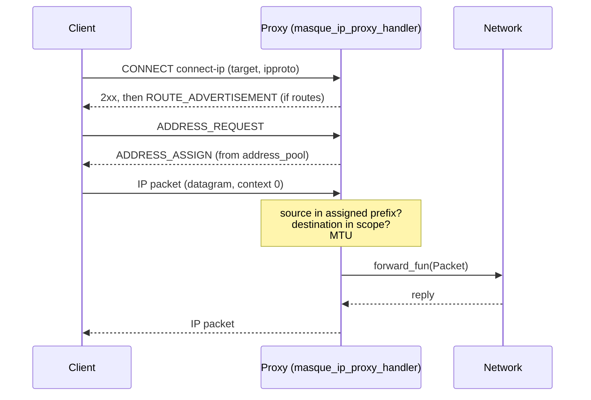

# CONNECT-IP

This page shows how to use CONNECT-IP (RFC 9484), which tunnels whole IP packets and adds a control plane for addresses and routes. It covers the client calls and messages, the server side with the built-in `masque_ip_proxy_handler` (address pools, routes, target scoping, forwarding), chaining, and the hooks an external consumer such as a TUN device uses. Read it when you build a VPN-like tunnel or a site-to-site link. It assumes [client](client.md), [server](server.md) and [handlers](handlers.md); "address assignment and routes" is defined in [concepts](../1-understand/concepts.md#address-assignment-and-routes). The RFC section map is in [conformance](../reference/conformance.md); the internals are in [CONNECT-IP internals](../3-change/connect-ip-internals.md).



## Client

```erlang
-include_lib("masque/include/masque_ip.hrl").

{ok, Sess} = masque:connect(<<"https://vpn.example:4443">>, {'*', '*'},
                            #{protocol => ip, transports => [h3, h2, h1]}),
{ok, [_Id]} = masque:request_addresses(Sess, [{4, {0,0,0,0}, 32}]),
receive
    {masque_address_assign, Sess, [#ip_assignment{address = Addr}]} -> Addr
end,
ok = masque:send_ip_packet(Sess, Packet),
receive {masque_ip_packet, Sess, Reply} -> Reply end.
```

The target is `{IpTarget, IpProto}`:

| `IpTarget` | Meaning |
|---|---|
| `'*'` | Any destination. |
| `{A, B, C, D}` or an 8-tuple | One address. |
| `{4, Address, PrefixLen}`, `{6, Address, PrefixLen}` | A prefix; host bits must be zero. |
| `<<"host.example">>` | A host name; the proxy resolves it before answering. |

`IpProto` is `'*'` or an IP protocol number `0..255`.

Calls:

| Call | Returns |
|---|---|
| `masque:send_ip_packet(Sess, Packet)` | `ok`, or `{error, {packet_too_large, Size, Mtu}}` above the `mtu` connect option (default 1500). |
| `masque:request_addresses(Sess, [{Version, Address, PrefixLen}])` | `{ok, RequestIds}`. The answer arrives as `masque_address_assign`. |
| `masque:assign_addresses(Sess, [#ip_assignment{}])` | `ok`. Nonzero request ids must answer an ADDRESS_REQUEST the proxy sent you, otherwise `{error, {no_such_pending_request, Id}}`. |
| `masque:advertise_routes(Sess, [#ip_route{}])` | `ok`. |
| `masque:ip_info(Sess)` | `#{assigned, routes, mtu, transport}`: the addresses the last ADDRESS_ASSIGN left you holding (rejection entries are not listed) and the last routes received. |

Messages to the application owner:

```erlang
{masque_ip_packet,           Sess, Packet}
{masque_address_assign,      Sess, [#ip_assignment{}]}
{masque_address_request,     Sess, [#ip_prefix_request{}]}   %% the proxy asks you
{masque_route_advertisement, Sess, [#ip_route{}]}
{masque_capsule,             Sess, Type, Value}              %% other capsule types
{masque_closed,              Sess, Reason}
```

Both sides may send all three control capsules (RFC 9484 section 5), so a site-to-site peer can assign addresses and advertise routes to the proxy as well. Each `masque_address_assign` is the full list: an address missing from it is withdrawn. Answer every `masque_address_request` with `assign_addresses/2`; the session keeps 64 of the proxy's requests waiting for you and answers the rest at once with the "no address" entry.

When you assign prefixes to the proxy, you know which sources its packets may use. Pass `source_filter => true` to `connect/3` to drop inbound packets from other sources (RFC 9484 section 11, BCP 38); they count as `bcp38` drops. Without it, packets reach you unchecked and the check is yours.

Things the client enforces:

- `capsule_protocol => false` is refused with `{error, {invalid_opts, capsule_protocol_required_for_ip}}`.
- A custom `uri_template` must be an absolute URI, otherwise `{error, {bad_template, absolute_uri_required}}`. The default is `https://<proxy>/.well-known/masque/ip/{target}/{ipproto}/`.
- On h3 the tunnel is refused with `{error, {mtu_too_low, Got, 1280}}` when the connection cannot carry 1280-byte datagrams (RFC 9484 section 7.2). h2 and h1 carry packets in capsules and are exempt. The client does not send the ICMPv6 echo probe of section 7.2; send it yourself to `ff02::1` if you need it, the default proxy handler answers.
- A malformed control capsule, an empty ADDRESS_REQUEST or an unordered ROUTE_ADVERTISEMENT from the proxy aborts the tunnel.

## Server

`masque_ip_proxy_handler` is the default `ip_handler`. Configure it in `handler_opts` (or at the top level, see [server](server.md#where-handler-options-go)):

```erlang
-include_lib("masque/include/masque_ip.hrl").

{ok, _} = masque:start_listener(vpn, #{
    port => 4443, cert => CertDer, key => Key,
    handler_opts => #{
        address_pool => {4, {10,200,0,0}, 16},
        routes => [#ip_route{version = 4, start_addr = {0,0,0,0},
                             end_addr = {255,255,255,255}, ip_protocol = 0}],
        allow_private => true,
        forward_fun => fun my_router:forward/2
    }
}).
```

| `handler_opts` key | Default | Meaning |
|---|---|---|
| `address_pool` | none | A prefix `{Version, Address, PrefixLen}`, an `#ip_route{}` range, or a list of them (one per IP version is used). Without a pool every ADDRESS_REQUEST gets the "no address" answer. |
| `min_assignable_prefix` | `#{4 => 32, 6 => 128}` | Widest prefix handed out per version (an integer applies to both). |
| `routes` | `[]` | `#ip_route{}` records advertised at start for `*`, prefix and address targets. A host name target advertises only its resolved addresses. |
| `max_assignments` | `1` | Addresses (or prefixes) one tunnel may hold per IP version. Past it, a request is answered with an address already held. |
| `allowed_source_prefixes` | `[]` | Extra `{Version, Address, PrefixLen}` prefixes packets may come from, besides the assigned ones. Use it when the client's addresses are not assigned by the proxy. |
| `allow_ip` | accept all | `fun({IpTarget, IpProto}) -> boolean()`, called in `accept/1`; `false` answers 403. |
| `mtu` | `1500` | Largest packet forwarded; larger ones get an ICMP error. |
| `ttl_decrement` | `encapsulation` | Where the TTL / hop limit is decremented. `encapsulation` (RFC 9484 section 7.2): on packets going into the tunnel. `decapsulation`: on the client's packets, as masque did before. See [forwarding](#forwarding). |
| `icmp_rate_limit` | `10` | ICMP errors one tunnel may generate per second (the burst is the same). `0` sends none. |
| `link_local_address` | `fe80::1` | The proxy's own address in the tunnel: echo requests to it or to `ff02::1` are answered from it. |
| `allow_private` | `false` | Lets the tunnel reach non-public destinations. It does not relax the source check. See [target scoping](#target-scoping). |
| `allow_self`, `self_addresses` | `false`, `[]` | Packets to the proxy's own addresses are dropped unless `allow_self`. |
| `forward_fun` | none (drop) | What to do with accepted packets. See [forwarding](#forwarding). |
| `lifecycle_fun` | none | Event callback. See [plumbing](#plumbing-for-external-consumers). |

Host name targets are resolved by the listener before `accept/1`, with the listener `resolver` (`fun(Host) -> {ok, [Address]} | {error, _}`, default A and AAAA lookup); a failure answers 502. The answer is in the request map as `resolved_addresses`.

### Address pools

On ADDRESS_REQUEST the handler walks the pool for the requested version and hands out the first free block. When the pool is a subnet, single addresses skip its reserved ones: the first address (the IPv6 subnet-router anycast address, the IPv4 network address) and, in IPv4, the last (broadcast), so a /24 gives `.1` to `.254` and an IPv6 /64 starts at `::1`. An `#ip_route{}` range that is not a whole subnet, a subnet of one or two addresses, and blocks shorter than a host route use the whole range. A request for a prefix length shorter than `min_assignable_prefix` gets the minimum; by default every client gets a single address (/32 or /128). To delegate IPv6 /64s while keeping IPv4 host routes:

```erlang
handler_opts => #{address_pool => [{4, {10,200,0,0}, 16}, {6, {16#2001,16#db8,0,0,0,0,0,0}, 48}],
                  min_assignable_prefix => #{4 => 32, 6 => 64}}
```

Each ADDRESS_ASSIGN the handler sends is the full set the client holds (RFC 9484 section 4.7.1): the entries answering this request, under their request ids, then every address assigned earlier, with request id 0. Asking for IPv6 after IPv4 gives back both, so treat each `masque_address_assign` as the new complete list.

Assignments are registered in `masque_ip_session_registry`, which also keeps sessions that share a pool from getting the same block. An exhausted pool answers with the RFC 9484 "no address" entry, and so does a pool where no free block turns up within a bounded number of probes. A tunnel holds at most `max_assignments` blocks per version (1 by default), so one client cannot drain a shared pool. The server session keeps at most 64 unanswered request ids per tunnel on every transport; extra requests are answered with "no address" at once, along with the addresses the client holds. Every request id gets an answer (RFC 9484 section 4.7.2): a handler without `handle_address_request/2`, or an `{assign, _}` that leaves ids out, has those ids answered with "no address" by the session.

### Target scoping

The handler lets a tunnel reach only what its target names:

| Target | Accepted when | Packets forwarded to |
|---|---|---|
| `'*'` | `allow_private => true` | any destination |
| prefix | both ends of the prefix are public, or `allow_private` | destinations inside the prefix |
| host name | every resolved address is public, or `allow_private` | its resolved addresses (static `routes` do not widen this) |
| address | public, or `allow_private` | that address |

Whatever the target, a non-public destination is dropped unless `allow_private` is set. A refused target answers 403. Packets must also match the requested `ipproto` (ICMP and ICMPv6 always pass, RFC 9484 section 4.6), and their source must lie inside a prefix assigned to this tunnel or in `allowed_source_prefixes` (BCP 38); before any assignment every other packet is dropped. On h3, a tunnel whose datagrams cannot carry a 1280-byte packet is refused with 502 (RFC 9484 section 7.2). Each drop is counted by reason (`bcp38`, `scope_target`, `scope_ipproto`, `malformed`), see [operations](operations.md#drop-counters), and answered with ICMP Destination Unreachable (ICMPv4 code 13; ICMPv6 code 5 for a bad source, code 1 otherwise) within `icmp_rate_limit`.

ICMPv6 echo requests sent to `ff02::1` or to `link_local_address` are answered before these checks, so a client can check the tunnel carries 1280-byte packets (RFC 9484 section 7.2).

### Forwarding

For each accepted packet the handler acts as a router, then calls `forward_fun`:

1. Compares the size with `mtu`. A larger packet is dropped (`mtu_exceeded`) and the client gets ICMPv4 Fragmentation Needed or ICMPv6 Packet Too Big carrying the MTU.
2. Never answers an ICMP error with another ICMP error, and rate limits the errors it sends (`icmp_rate_limit`).
3. Calls `forward_fun(Packet, State)` with the packet as the client sent it. `State` is the handler's own state: give it back unchanged unless you replace the handler.
4. Decrements the TTL (fixing the IPv4 header checksum) or hop limit of the packets `forward_fun` sends back into the tunnel (`{reply, _, _}` and `{send_ip_packet, _}`). One that runs out is dropped (`ttl_zero`) and ICMP Time Exceeded for its source goes to `forward_fun`. Packets built by an `{icmp_error, _}` action are the proxy's own and keep their TTL.

RFC 9484 section 7.2 has endpoints decrement on encapsulation, not on decapsulation. With `ttl_decrement => decapsulation` the handler decrements the client's packet before step 1 instead (at zero it is dropped and the client gets Time Exceeded) and sends replies as they are, as masque did before.

`forward_fun` also receives the ICMP errors for packets that could not go into the tunnel: their source is on your side. They arrive through the handler's `handle_info({masque_ip_icmp, Icmp}, State)` and are passed to `forward_fun` without checks.

`forward_fun` returns one of:

| Return | Effect |
|---|---|
| `{reply, Packet, State}` | Send `Packet` back to the client. |
| `{forward, State}`, `ok`, `{error, _}` | Nothing more; you took care of the packet. |
| `{drop, State}` | Count a `forward_drop`. |
| `{actions, Actions, State}` | Run several actions: `{send_ip_packet, Pkt}`, `{icmp_error, {Kind, Spec, Invoking}}`, and `{drop, Reason}` (counted, nothing sent). Other handler actions pass through too. |

```erlang
forward(Pkt, S) ->
    case my_routes:lookup(Pkt) of
        {ok, Iface} -> my_tun:write(Iface, Pkt), {forward, S};
        none -> {actions, [{icmp_error, {dest_unreachable, {v4, 0}, Pkt}},
                           {drop, forward_drop}], S}
    end.
```

`masque_icmp` builds the ICMP errors (`dest_unreachable/3`, `packet_too_big/2`, `frag_needed/2`, `time_exceeded/2,3`); `masque_ip_packet` has the packet helpers (`decrement_ttl/1`, `checksum/1`, `destination/1`, `scope_check/4`).

### Chained CONNECT-IP

`masque_chain_handler` relays CONNECT-IP to an upstream proxy. Packets go both ways, and so do the control capsules: the upstream's ROUTE_ADVERTISEMENT and every ADDRESS_ASSIGN (an empty one too, it withdraws everything) are passed to the client, the client's ADDRESS_ASSIGN and ROUTE_ADVERTISEMENT go upstream. A client ADDRESS_REQUEST is sent upstream and the answer is relayed back under the client's request ids; if the upstream cannot take the request, the client gets "no address" at once, with the addresses it already holds. An upstream ADDRESS_REQUEST goes to the client under the upstream's ids and the client's answer goes back. The chain hop does not register addresses in its own registry. See [relay](relay.md).

## Plumbing for external consumers

A process that owns a TUN device, or any other packet source, can drive CONNECT-IP without writing a handler.

**Find the session for an address.** `masque_ip_session_registry` maps every assigned block to the session serving it. Lookups read ETS directly.

```erlang
case masque_ip_session_registry:lookup(DstAddr) of
    {ok, SessionPid, _ContextId} -> masque_ip:inject_packet(SessionPid, Packet);
    not_found -> drop
end.
```

Other calls: `register/5` (returns `{error, conflict}` on overlap), `release/3,4`, `release_pid/1`, `all/0`. Entries of a session that dies are removed automatically.

**Push a packet to the client.** `masque_ip:inject_packet(SessionPid, Packet)` is an asynchronous cast accepted by the h3, h2 and h1 IP sessions, sent like a `{send_ip_packet, _}` action. On h3 a packet injected before the 2xx is held and sent after it. The session decrements its TTL first, as a router does on encapsulation (not with `ttl_decrement => decapsulation`); one that runs out is dropped (`ttl_zero`).

**Get the ICMP errors for your packets.** On h3 a packet, injected or sent by the handler, that does not fit a QUIC DATAGRAM frame is dropped (`mtu_exceeded`, RFC 9484 section 10.1). For it, and for an injected packet whose TTL ran out, the session sends its handler `{masque_ip_icmp, Icmp}`: an ICMP Packet Too Big / Fragmentation Needed or Time Exceeded addressed to the packet's source, within `icmp_rate_limit`. The default handler passes it to `forward_fun`; a handler of your own gets it in `handle_info/2`.

**Watch events.** `lifecycle_fun => fun(Event, Detail) -> _ end` in `handler_opts`:

| Event | Detail |
|---|---|
| `address_assigned` | `#{version, address, prefix_len, entry}` |
| `address_released` | `#{version, address, prefix_len}` |
| `route_advertised` | `#{routes}` |
| `packet_dropped` | `#{reason, packet_size}` |
| `peer_address_assigned` | `#{entries}`: the client assigned addresses to the proxy |
| `peer_routes_advertised` | `#{routes}`: the client advertised routes |

Exceptions in `lifecycle_fun` are swallowed. Use it to program kernel routes on assign and release.

**Count your own drops.** For a data path you run yourself, `masque_ip_proxy_handler:emit_drop(Reason, Detail, HandlerOpts)` bumps the same drop counter and calls the `lifecycle_fun` found in `HandlerOpts` with `packet_dropped`. `emit_drop/2` only bumps the counter.

Next: [connect-udp-bind](connect-udp-bind.md) or [relay](relay.md).
