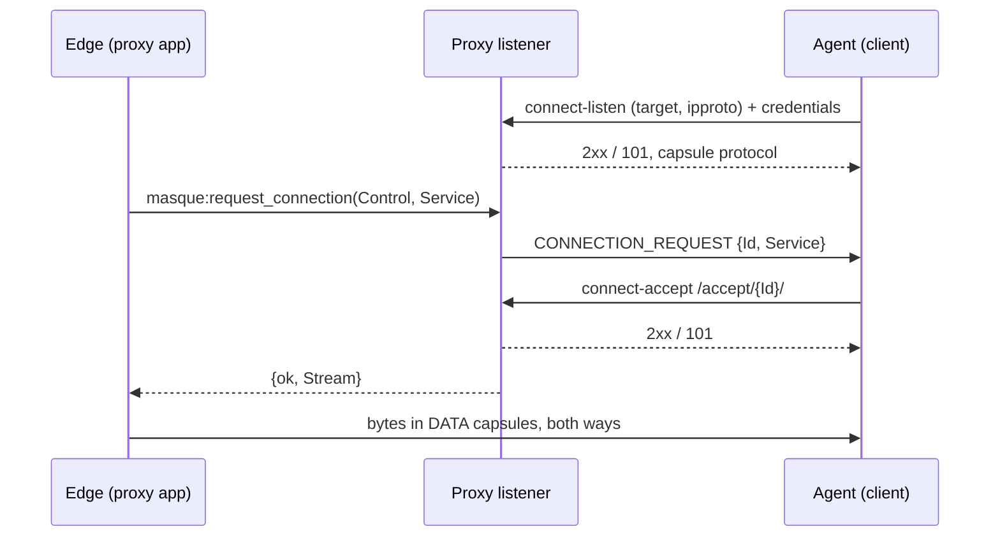

# Reverse connect

This page shows how to use reverse connect (draft-rosomakho-masque-reverse-connect-01), which lets a client behind NAT or a firewall accept inbound connections through the proxy. The client keeps a control channel open; when the proxy wants a connection, it asks over that channel and the client answers by opening an accept stream. Read it when you expose a local service through a proxy, as a tunnel agent does. It assumes [client](client.md), [server](server.md) and [CONNECT-TCP](connect-tcp.md). The section map is in [conformance](../reference/conformance.md#draft-rosomakho-masque-reverse-connect-01).



## Proxy side

Turn it on per listener and give it a listen handler. The draft requires authenticated clients, so without a handler every control channel is refused.

```erlang
{ok, _} = masque:start_listener(edge, #{
    port => 443, cert => Cert, key => Key,
    accept_listen => true,
    listen_handler => my_listen_handler
}).
```

The handler authenticates each control channel and learns the session that serves it:

```erlang
-module(my_listen_handler).
-behaviour(masque_listen_handler).
-export([authenticate/1, init/2, handle_services/2, terminate/2]).

authenticate(#{headers := Headers}) ->
    case lists:keyfind(<<"authorization">>, 1, Headers) of
        {_, <<"Bearer ", Token/binary>>} -> check_token(Token);
        false -> {reject, {other, 401}}
    end.

%% Runs in the control session: self() is the handle for request_connection.
init(Agent, _Req) ->
    my_registry:add(Agent, self()),
    {ok, Agent}.

handle_services(Services, Agent) ->
    my_registry:services(Agent, Services),
    {ok, Agent}.

terminate(_Reason, Agent) ->
    my_registry:remove(Agent).
```

Ask the agent for a connection, then use the stream:

```erlang
Service = #{destination => local, protocol => tcp, port => 8080},
{ok, Stream} = masque:request_connection(Control, Service, #{timeout => 10000}),
ok = masque:send(Stream, Request),
receive
    {masque_data, Stream, Bytes} ->
        ok = masque:consumed(Stream, byte_size(Bytes))
end.
```

- `request_connection/3` returns `{error, declined}`, `{error, timeout}` or `{error, closed}` when no stream comes.
- The caller owns the stream: it gets `{masque_data, Stream, Bytes}`, `{masque_closed, Stream, peer_fin}` when the agent finished sending, and `{masque_closed, Stream, Reason}` when the stream ends, unless it closed the stream itself.
- Credit returns only through `consumed/2`, so an edge that stops reading stops the agent too.
- `send/2` returns once the bytes are on the stream; `shutdown_write/1` half-closes; `close/1` ends it.

## Agent side

```erlang
{ok, Listen} = masque:reverse_listen(<<"https://edge.example">>, {local, tcp}, #{
    transports => [h3],
    request_headers => [{<<"authorization">>, <<"Bearer ", Token/binary>>}]
}),
ok = masque:advertise_services(Listen, [#{destination => local, protocol => tcp, port => 8080}]),
receive
    {masque_connection_request, Listen, Id, #{port := 8080}} ->
        {ok, Stream} = masque:reverse_accept(Listen, Id),
        relay(Stream, connect_local(8080));
    {masque_connection_request, Listen, Id, _Other} ->
        ok = masque:reverse_decline(Listen, Id)
end.
```

- `{Target, IpProto}` is the scope you accept: `local` (your own services), `'*'`, a host name, `{wildcard, Domain}`, an address or a prefix; and `tcp`, `udp` or `'*'`.
- For a TCP service the accept stream is a CONNECT-TCP tunnel: `masque:send/2`, `{masque_data, Stream, Bytes}`, `shutdown_write/1`, `close/1`. For a UDP service it is a CONNECT-UDP tunnel, one datagram per message. Connect it to the service the request named; if that fails, close the stream.
- `masque:migrate(Listen)` moves the HTTP/3 connection to a new address; the accept streams on it move too.
- `{masque_closed, Listen, Reason}` arrives if the proxy ends the channel; `masque:close(Listen)` ends it from your side.

## Notes

- On HTTP/3 and HTTP/2 the channel gets a connection of its own, and every accept stream runs on it, as the draft requires. Closing the channel closes them all. On HTTP/1.1 each accept is a new TLS connection, matched to the channel by the identity `authenticate/1` returns.
- An accept for an id the proxy did not issue, or one that comes on another connection or with another identity, gets 404.
- The control channel has no idle timeout by default (`listen_idle_timeout_ms` sets one). QUIC keepalives keep an HTTP/3 channel up.
- Capsule writes on the channel wait for the transport instead of being dropped, so a busy connection cannot lose a request.
- The draft has not assigned capsule codes yet; masque uses provisional values (see [conformance](../reference/conformance.md#draft-rosomakho-masque-reverse-connect-01)). Only masque peers speak them.
- A UDP service's stream carries one datagram per `{masque_data, Stream, Payload}` and per `send/2`. UDP has no flow control: datagrams too large for the path are dropped, and `consumed/2` does nothing.
