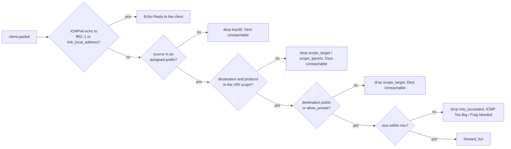

# CONNECT-IP internals

This page explains how the proxy side of CONNECT-IP (RFC 9484) is split between the session, the default handler and the address registry, and what checks every client packet goes through. Read it before you change address allocation, the forwarding checks, or chain relaying of address requests. For the user view (options, messages, examples) see [connect-ip](../2-use/connect-ip.md).

## Who does what

| Piece | Responsibility |
|---|---|
| `masque_ip_server_session` (h3, h2), `masque_ip_h1_server_session` | Capsule and datagram decode, the list of unanswered client ADDRESS_REQUEST ids (`peer_pending`), the addresses the last ADDRESS_ASSIGN left the client holding (`held`), sending ADDRESS_ASSIGN / ROUTE_ADVERTISEMENT / ADDRESS_REQUEST, `inject_packet` casts (TTL decrement), the h3 datagram size check on the way into the tunnel |
| `masque_ip_proxy_handler` | The SSRF gate in `accept/1`, the initial route advertisement, the address allocator, the per-packet forwarding checks, `lifecycle_fun` events |
| `masque_ip_session_registry` | Which session serves which address, across sessions and pools |
| `masque_ip` | Helpers: `is_public/1`, `resolve_target/3`, `reject_requests/1`, `is_rejection/1`, `held_set/1`, `inject_packet/2`, and the internal ones the sessions share (`ttl_mode/1`, `icmp_rate_limit/1`) |
| `masque_icmp` | ICMP error builders, `echo_reply/2`, `may_answer/1`, the per-tunnel token bucket (`limiter/1`, `allow/1`) |
| `masque_ip_capsule` | Codec and validation; `normalize_routes/1` puts a route list in ROUTE_ADVERTISEMENT order |

The listener resolves a hostname target before `accept/1` (`masque_ip:resolve_target/3`), so the handler sees `resolved_addresses`.

## Session: request ids

When the client sends ADDRESS_REQUEST, the session records each non-zero request id in `peer_pending` before calling `handle_address_request/2`. An `{assign, Entries}` action is sent only if every non-zero id in it is pending (id 0, an unprompted assignment, is always allowed); the matching ids are then removed, and the entries (rejections dropped, ids set to 0) become `held`. An assign that fails the check is dropped. At most 64 ids may be pending, on every transport; request entries past that are answered at once with the RFC 9484 "no address" entry.

RFC 9484 section 4.7.2 says every request id gets an answer, so the session fills the gaps:

- The handler does not export `handle_address_request/2`: every entry is answered with "no address".
- The handler's result carries an `{assign, _}`: ids of this request still pending afterwards (left out, or the assign was refused) are answered with "no address".
- The handler returns no `{assign, _}`: the ids stay pending; the handler answers later. The chain handler works this way.

Every ADDRESS_ASSIGN the session sends on its own starts with `held`, because one that leaves an address out withdraws it (section 4.7.1). The client sessions do the same for the proxy's requests: 64 wait for the owner, the rest are answered with `sent_held` (what the client last assigned to the proxy) plus "no address".

A proxy-initiated `{request_addresses, List}` takes `{Version, Address, PrefixLen}` tuples, which get a fresh request id, or `#ip_prefix_request{}` records, which keep theirs (the chain handler relays the upstream's ids this way).

## Accept and init

`accept/1` passes when `allow_private` is set, or when the target is public: `'*'` never is; a prefix must start and end on public addresses; a literal must be public; a hostname needs every resolved address public. `allow_ip` must also return true. Otherwise `{reject, forbidden}` (403).

`init/2` builds the route list from the static `routes` option plus a host route per resolved address; for a hostname target, from the resolved addresses only. `masque_ip_capsule:normalize_routes/1` sorts it by (version, protocol, start), merges overlapping or adjacent ranges and trims protocol ranges a protocol-0 range covers, so it always encodes. If it is not empty it returns `{advertise, Routes}`, which becomes the initial ROUTE_ADVERTISEMENT. A session that cannot encode an `{advertise, _}` from any handler logs a warning and sends nothing. The default handler sends no unprompted ADDRESS_ASSIGN.

## Allocator

`handle_address_request/2` answers every request entry:

1. Quota: once the session holds `max_assignments` blocks of a version (default 1), a further entry is answered with a block it already holds.
2. No `address_pool`: every entry gets the "no address" reply (`masque_ip:reject_requests/1`: all-zero address, prefix 32 or 128).
3. The first pool range of the requested IP version is used; `address_pool` may be a prefix, an `#ip_route{}` or a list of them.
4. The prefix length is the requested one clamped to `[min_assignable_prefix, 32 | 128]`; by default only host addresses are handed out.
5. Candidates are stride-aligned blocks walked from the start of the range, at most 4096 of them per entry. A block is skipped if it overlaps an assignment this session already holds, or if `register/5` in `masque_ip_session_registry` returns `{error, conflict}` because another session holds it. The first free block wins: this is first-fit.
6. Pool exhausted, or no free block within the probe limit: that entry gets the "no address" reply.

Each successful assignment bumps `ip_assign_inc/0` and emits `address_assigned` through `lifecycle_fun`.

## Registry

`masque_ip_session_registry` is a `gen_server` under `masque_sup` with a public ETS `ordered_set` keyed by `{Version, StartInt}` holding `{EndInt, Prefix, SessionPid, ContextId, MonitorRef}`.

- Writes go through the server. `register/5` refuses any overlap with an existing range, so at most one range covers an address.
- `lookup/1` reads ETS directly (`ets:prev/2` to the closest start, then an end check), so lookups do not queue on the server.
- Every registration monitors the session; on `'DOWN'` the session's ranges are removed.
- The table is created by `masque_sup` (`new_table/0`), so a crash of the registry does not lose the assignments; the restarted registry monitors the sessions found in the table again and drops the rows of dead ones.
- `release/4` removes a range only for the pid that owns it. The handler releases its ranges in `terminate/2` and emits `address_released`.
- All write calls are no-ops when the registry is not running. In that case `register/5` returns `ok`, so sessions sharing a pool are no longer kept apart.

A TUN-style consumer finds the serving session with `lookup/1` and sends it a packet with `masque_ip:inject_packet/2`, a cast that both IP session modules turn into a `{send_ip_packet, _}` action (held in the early queue until the h3 2xx).

## Forwarding checks

Every IP packet from the client goes through `handle_ip_packet/2`, in this order. A failure drops the packet, bumps `masque_metrics:ip_drop_inc(Reason)` and emits `packet_dropped` to `lifecycle_fun`.

- **Link-local echo.** RFC 9484 section 7.2: an ICMPv6 Echo Request to `ff02::1` or to `link_local_address` (default `fe80::1`) is answered from `link_local_address` before any other check; it never leaves the tunnel. This is how a peer checks the tunnel carries 1280 bytes.
- **Source filter (BCP 38).** The source must be inside a prefix assigned to this session or in `allowed_source_prefixes`. `allow_private` does not affect it.
- **Scope.** `masque_ip_packet:scope_check/4` matches the destination against the request's `target` and the protocol against `ipproto`, after walking the IPv6 extension headers. ICMP (IPv4) and ICMPv6 (IPv6) always match `ipproto`. A hostname target matches when the destination is one of its resolved addresses.
- **Destination filter.** Non-public destinations are dropped unless `allow_private`, whatever the target.
- **ICMP for drops.** Section 7.2.1: source, scope and destination drops are answered with Destination Unreachable (ICMPv4 code 13; ICMPv6 code 5 for the source, code 1 otherwise).
- **MTU.** `mtu` in `handler_opts`, default 1500. Larger packets get ICMPv6 Packet Too Big or ICMPv4 Fragmentation Needed.
- **No ICMP about ICMP.** `masque_icmp:may_answer/1`: no ICMP error is generated when the offending packet is itself an ICMP error, goes to a multicast or broadcast address or comes from an unspecified or multicast one.
- **Rate limit.** Every ICMP error the handler generates takes a token from a per-tunnel bucket (`icmp_rate_limit`, default 10 per second, created on first use). An empty bucket sends nothing; the drop is still counted.
- **forward_fun.** The accepted packet goes, unchanged, to `forward_fun/2` from `handler_opts`. Without one the packet is dropped without a drop count. The fun may return the older `{reply, _, _}`, `{drop, _}`, `{forward, _}`, `ok`, `{error, _}` shapes or `{actions, List, State}`; `{drop, Reason}` entries in the list are counted and never reach the session.

## TTL and the way into the tunnel

RFC 9484 section 7.2: the TTL / Hop Limit is decremented upon encapsulation, not decapsulation. The proxy decapsulates the client's packets and encapsulates what it sends into the tunnel, so:

- The client's packets keep their TTL (`route/2` in `masque_ip_proxy_handler`).
- `{send_ip_packet, _}` packets that `forward_fun` returns (`{reply, _, _}` or in `{actions, _, _}`) are decremented by the handler (`into_tunnel/2`). One that runs out is dropped (`ttl_zero`) and the handler sends itself `{masque_ip_icmp, TimeExceeded}`.
- `inject_packet` packets are decremented by the session (`inject_ttl/2`); one that runs out is dropped (`ttl_zero`) and the session sends itself `{masque_ip_icmp, TimeExceeded}`.
- ICMP errors masque builds, and `{icmp_error, _}` actions, are the proxy's own and are not decremented.

`ttl_decrement => decapsulation` in `handler_opts` restores the earlier behaviour: the handler decrements the client's packet (Time Exceeded to the client at zero) and nothing going into the tunnel is touched. `ttl_mode/1` in `masque_ip` reads the option for the handler and the sessions.

On h3, `do_actions/2` checks every `{send_ip_packet, _}` against `max_datagram_size/2` in `masque_out` minus the context id byte (section 10.1). A packet that does not fit is dropped (`mtu_exceeded`) and the session sends itself `{masque_ip_icmp, Icmp}` with Packet Too Big (Fragmentation Needed for IPv4) carrying the room left. h2 and h1 have no such limit.

`{masque_ip_icmp, Icmp}` reaches the handler's `handle_info/2` like any other message. Its destination is the source of the dropped packet, on the handler's side of the tunnel: the default handler passes it to `forward_fun` without checks, the chain handler sends it upstream. The session and the handler each hold their own `icmp_rate_limit` bucket, so each error is limited once, by whoever built it.

## Chain relay of ADDRESS_REQUEST

`masque_chain_handler` forwards a client's ADDRESS_REQUEST upstream instead of allocating:

1. `handle_address_request/2` calls `masque:request_addresses/2` on the upstream session and stores `UpstreamId => ClientId` in `id_map`. It returns no `{assign, _}`, so the ids stay pending in the ingress session. If the upstream cannot take the request it replies at once with the addresses the client holds plus the "no address" entries.
2. When the upstream answers with `{masque_address_assign, Up, Entries}`, the whole list is relayed, even when empty (it withdraws everything): entries with request id 0 pass through, entries with a mapped id go under the client's id, other entries go as id 0, and a rejection for an unknown id is dropped. The relayed list (rejections dropped, ids set to 0) is kept as `held`.
3. The upstream's ROUTE_ADVERTISEMENT is relayed as `{advertise, Routes}`. On h3, relays that arrive before the ingress 2xx wait in the session's early queue.

The other direction:

- The client's ADDRESS_ASSIGN goes upstream with `masque:assign_addresses/2`, and its ROUTE_ADVERTISEMENT with `masque:advertise_routes/2`.
- An upstream `{masque_address_request, Up, Requests}` becomes `{request_addresses, Requests}` with the upstream's ids, which are remembered in `up_requests`. When the client answers, an entry with such an id keeps it (the upstream session checks it is pending); any other non-zero id goes as 0.
- `{masque_ip_icmp, Icmp}` from the ingress session (a packet from upstream that did not fit the client's tunnel) goes back upstream.

Tests: `masque_ip_proxy_handler_tests`, `masque_ip_session_registry_tests`, `masque_ip_packet_tests`, `masque_icmp_tests`, `masque_ip_capsule_tests`, `masque_chain_handler_tests`, `masque_chain_ip_SUITE`, `masque_ip_compliance_SUITE` (h3, h2 and h1 groups, with the `masque_ip_script_handler` fixture for the proxy-to-client capsules), `masque_ip_compliance_h1_SUITE`, and the `ip_*` cases of `masque_e2e_SUITE`.

Next: [udp-bind internals](udp-bind-internals.md).
